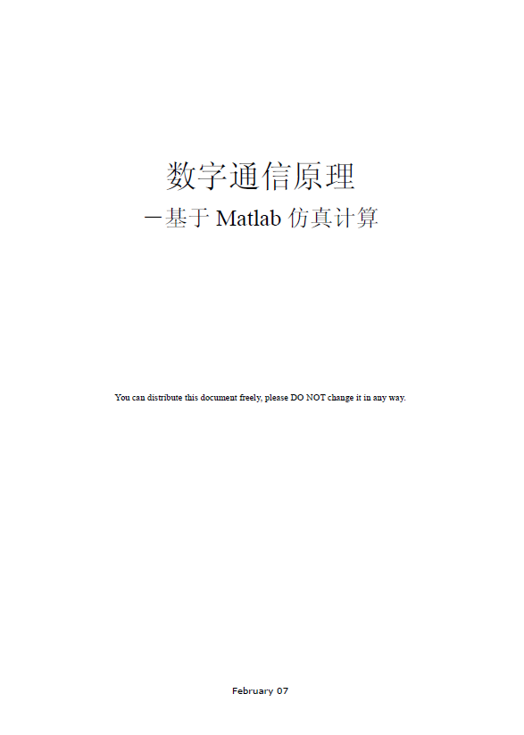
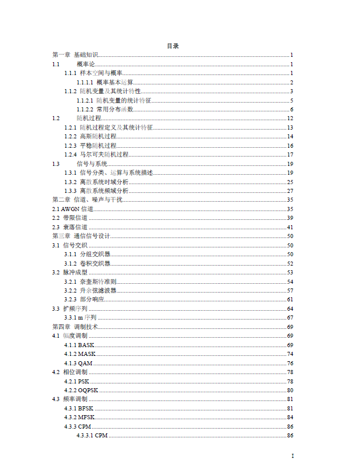
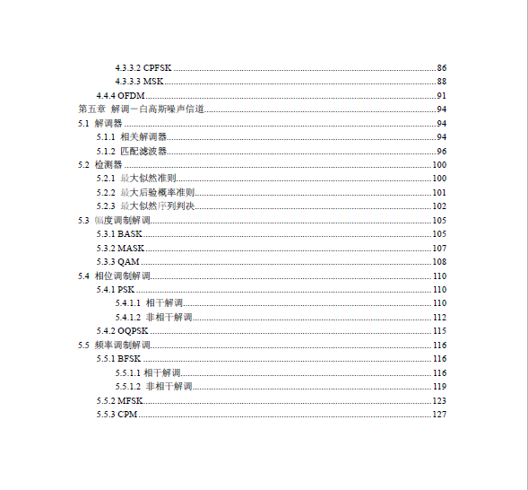

# Digital Communication Principles - Based on MATLAB Simulation and Computation in the book "Digital Communication Principles - Based on MATLAB Simulation and Computation"

1. Digital Communication Principles - Based on MATLAB Simulation and Computation
This book implements communication system channel (Gaussian, band-limited, fading) modeling, signal interleaving, pulse shaping, spread spectrum sequence design, and various mainstream modulation methods such as BASK, MASK, QAM, PSK, OQPSK, BFSK, MFSK, CPM, CPFSK, MSK, OFDM through MATLAB. It also includes receiver signal demodulation, matched filtering, and simultaneously designs detectors based on the maximum likelihood criterion, maximum a posteriori probability criterion, and maximum likelihood sequence decision.

## Images

<!-- PAYMENT_BLOCK -->

## Get this dataset

- Payment link (Stripe): [Buy now](https://buy.stripe.com/3cs8yP7sY87d0vu9AB)
- Payment QR code: 

<!-- /PAYMENT_BLOCK -->
